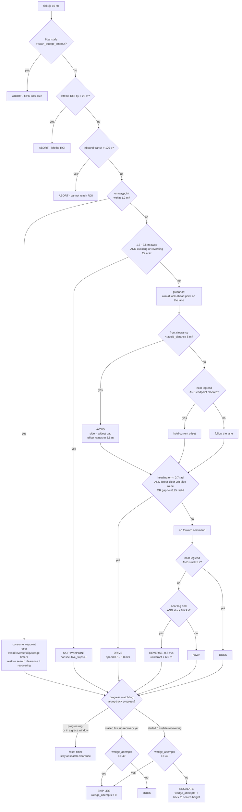
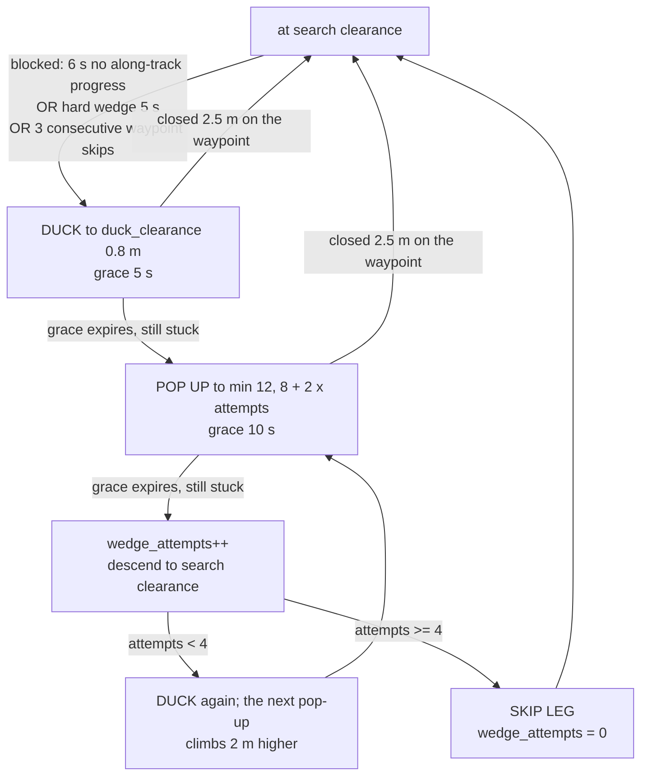

## Testing the Boustrophedon Sweep

Terminal 1:

``` bash
ros2 launch rs1_sim rs1_sim.launch.py husky:=false rviz:=false
```
headless:=True if you dont want gazebo

Terminal 2:

``` bash
ros2 launch rs1_perception tree_identification.launch.py
```

Terminal 3:

``` bash
ros2 launch rs1_mission roi_sampling_test.launch.py
```

Terminal 4 - RViz view

``` bash
ros2 launch rs1_mission roi_sampling_viz.launch.py roi_x_min:=62 roi_y_min:=-88 roi_x_max:=92 roi_y_max:=-58
```

Terminal 5 test run:

``` bash
ros2 run rs1_mission test_roi_sampling.py --roi 62 -88 92 -58
```

BIGGER SWEEPS

``` bash
ros2 launch rs1_mission roi_sampling_viz.launch.py roi_x_min:=0 roi_y_min:=-90 roi_x_max:=80 roi_y_max:=10
```

``` bash
ros2 run rs1_mission test_roi_sampling.py --roi 0 -90 80 10 --timeout 2400
```

### What flies the sweep

The lanes are flown by **Nav2** (`NavigateThroughPoses`), not by a bespoke
velocity controller. Terrain following follows the sweep because it watches the
`navigate_through_poses` action status as well as `navigate_to_pose`, so the
search-clearance descent the executor requests via `/parrot1/set_clearance`
takes effect while the sweep is executing.

`sweep_controller` still accepts `velocity` as a legacy opt-out, but that path
does not move: terrain following sits in hover mode whenever no Nav2 goal is
executing, and hover drops every `cmd_vel`.

### Sweep start: fly in from the nearest corner (default)

No teleport by default. The executor picks the ROI corner nearest the drone and
starts the boustrophedon from there (lane order and lane direction are chosen to
match), so the run begins with the shortest possible transit instead of crossing
the whole box. It logs the chosen corner and the transit distance:

```
Sweeping from the ROI corner nearest (90.0, -48.0): 23.4 m transit to the first waypoint (100.0, -3.0)
Entered the ROI; starting the sweep lanes
```

The inbound leg is not treated as "leaving the ROI" (`roi_enter_margin`); only the
leg itself is time-bounded (`roi_transit_timeout`, 120 s). It also flies at
`transit_clearance` and only descends to `search_clearance` once it is inside the
box, so the whole inbound leg is not flown at canopy height:

```
Transiting to the ROI at the transit clearance; the drone will descend to the search clearance on arrival
Sweeping from the ROI corner nearest (90.0, -48.0): 23.4 m transit to the first waypoint (100.0, -3.0)
Entered the ROI; starting the sweep lanes
Descending to the search clearance for the sweep
```

To skip the transit and be placed at the nearest corner instantly, use `--teleport`
(this needs a SLAM re-initialisation after the jump):

``` bash
ros2 run rs1_mission test_roi_sampling.py --roi 0 -90 80 10 --teleport
```

`--no-teleport` is still accepted as a no-op alias.

### If the sweep flies away or leaves the ROI

The sweep plans and controls in **`parrot1_odom`** (`sweep_frame_`), NOT in the SLAM
map. That matters because `parrot1_odom` is the EKF output, which fuses the exact
Gazebo pose, so it equals `world` numerically. A bad `world <-> parrot1_map`
registration therefore cannot make the drone chase waypoints in the wrong place -
but a corrupt EKF pose still can. Two guards catch that:

* `test_roi_sampling.py` verifies `parrot1_map` still agrees with the (ground-truth)
  odometry frame before sampling (`--teleport` additionally re-initialises SLAM
  **after** odometry has settled and checks the drone sits on the ROI start). Both
  exit 2 with `parrot1_map is N m away from the odometry frame` on failure.
* The executor aborts with `drone left the ROI by more than 20 m` (tunable via
  `roi_escape_margin` / `roi_escape_timeout`) instead of flying off.

#### SLAM is on by default, and it drifts

`robot_bringup.launch.py` declares `slam` with **default `True`**, so a plain
`ros2 launch rs1_sim rs1_sim.launch.py` starts slam_toolbox. That is the usual
reason the map "drifts": slam_toolbox is scan-matching a **3 Hz** sweep taken
*inside* the oak branch band on a highly repetitive forest, which is a
fundamentally ill-conditioned problem on this world (a measured
`parrot1_map -> parrot1_odom` has been as bad as `[72, -15, +164]`).

SLAM drift does **not** degrade tree locations: perception anchors on
`parrot1_odom` and the executor plans in `parrot1_odom`. It only affects the
displayed map and Nav2's costmaps. So for a clean sweep, take SLAM out of the loop
entirely - nothing then scan-matches, and `parrot1_map` is pinned to odometry with a
static identity transform:

``` bash
ros2 launch rs1_sim rs1_sim.launch.py husky:=false rviz:=false slam:=false
```

If you do need a real occupancy map, the honest options are to tune
`rs1_localisation/config/parrot/slam_params_parrot1.yml` (`minimum_travel_distance`
is `0.0`, i.e. a map node on almost every scan; `max_laser_range: 40.0` drags in
canopy returns) or to build the map by accumulating the lidar in the `parrot1_odom`
frame, which has no drift by construction because that frame *is* the truth.

The README's older claim that "the sweep plans in `parrot1_map`" was stale; the code
sets `sweep_frame_ = "parrot1_odom"`.

Check the chain before sweeping:

``` bash
ros2 run tf2_ros tf2_echo parrot1_odom parrot1_base_link   # must match /parrot1/odometry
ros2 run tf2_ros tf2_echo parrot1_map  parrot1_odom        # identity
ros2 run tf2_ros tf2_echo world        parrot1_map         # ~identity
ros2 topic echo /parrot1/odometry --once --field pose.pose.position
```

Teleop Terminal (cmd vel is husky1 and parrot1):

``` bash
ros2 run teleop_twist_keyboard teleop_twist_keyboard --ros-args -r cmd_vel:=/husky1/cmd_vel
```

## When the drone gets stuck in a tree

The oak trees in `v2_forest.sdf` are single static meshes. Their geometry (mesh
bbox, scaled by 0.0254) is:

| part   | height above the tree base |
| ------ | -------------------------- |
| trunk + limbs (bark) | -0.1 - 5.5 m |
| branches (canopy)    | 1.2 - 6.5 m |

The drone is **kinematic** (`ignition-gazebo-velocity-control-system`), so it can
never physically jam on a branch. "Stuck in a tree" always means the sweep
controller is commanding zero/oscillating velocity because the level scan ring
(`/parrot1/scan`, the middle ring of the 9-ray lidar, at the drone's altitude)
sits inside the branch band and sees obstacles on every bearing.

The only clear altitudes are **below ~1.2 m** (trunk level, where only widely
spaced trunks remain) and **above ~6.5 m** (above the canopy). A clearance in
between - including the default 2.2 m search altitude - is inside the branches;
that is expected, and the sweeps rely on gap seeking plus the recoveries below.

Recovery ladder (`parrot_mission_executor`), triggered by the no-progress
watchdog, the near-leg-end hard-wedge timer, or repeated skipped legs:

1. **Duck** to `duck_clearance` (0.8 m) - below the branch band.
2. If the duck does not make along-track progress in `duck_grace_ticks`, **pop
   up** to `popup_clearance` (8 m, above the 6.5 m canopy).
3. If the pop-up also fails, descend and **escalate**: every further pop-up in
   the same wedge climbs `popup_step` (2 m) higher, up to
   `popup_max_clearance` (12 m).
4. The ladder resets (`wedge_attempts = 0`) as soon as the drone closes
   `alt_recover_travel` metres on its waypoint at the altered height - so the
   drone changes height, moves a couple of metres, and immediately returns to
   the search clearance instead of staying high for the rest of the lane.

The duck/pop-up targets are **above-ground** clearances applied through the
terrain-following node, so they follow the terrain (which rises up to ~7 m in
`v2_forest`). `min_clearance` in `rs1_navigation/config/terrain_following_params.yml`
must stay below `duck_clearance`, otherwise the descent clamp stops the duck
before it reaches trunk level.

Tunables: `duck_clearance`, `popup_clearance`, `popup_step`,
`popup_max_clearance`, `alt_recover_travel`, `duck_grace_time`,
`popup_grace_time`, `max_recovery_attempts`, `no_progress_timeout`,
`hard_wedge_timeout`.

The ladder is bounded: after `max_recovery_attempts` rungs on the same spot the
leg is abandoned (that is the only case in which the drone "gives up" on a lane).
A hopeless spot costs roughly 6 s + 5 s + 10 s per rung (~56 s for 4 rungs).

### Decision tree: how the sweep picks an action

Every tick is `sweep_control_hz` (10 Hz) of `sweepControlCb`. The order matters:
**guards -> waypoint bookkeeping -> guidance -> blocking checks -> progress
watchdog**, so an abort always wins over a recovery, and a consumed waypoint
resets every timer before the watchdog can look at them.



### Decision tree: the recovery ladder



### Thresholds that drive the decisions

| parameter | value | decides |
| --- | --- | --- |
| `sweep_control_hz` | 10.0 | tick rate of the whole tree above |
| `waypoint_tolerance` | 1.2 m | waypoint counts as reached |
| `waypoint_skip_distance` | 2.5 m | how close is "close enough to give up on it" |
| `waypoint_skip_time` | 4.0 s | how long to fight before skipping a waypoint |
| `lookahead_distance` | 5.0 m | steering point; also defines "near leg end" |
| `avoid_distance` | 5.0 m | front clearance that engages avoidance |
| `avoid_offset` / `avoid_rate` | 3.5 m / 1.2 | detour width and how fast it ramps in |
| `avoid_disengage_margin` | 1.5 m | must clear to 6.5 m for 4 ticks to disengage |
| `obstacle_stop_distance` | 2.5 m | below this the route counts as blocked |
| `heading_gate` | 0.7 rad | don't drive with a big heading error |
| `min_gap_width` | 0.25 rad | widest-gap test for "a route exists" |
| `no_progress_timeout` | 6.0 s | along-track stall before a recovery |
| `hard_wedge_timeout` | 5.0 s | no-forward-route stall near a leg end |
| `duck_clearance` / `duck_grace_time` | 0.8 m / 5 s | first rung |
| `popup_clearance` / `popup_step` / `popup_max_clearance` | 8 / 2 / 12 m | escalation |
| `popup_grace_time` | 10 s | how long a climb gets to work |
| `max_recovery_attempts` | 4 | rungs before the leg is sacrificed |
| `max_consecutive_skips` | 3 | waypoint skips that trigger a duck |
| `alt_recover_travel` | 2.5 m | how far past the obstacle before resuming height |

### Four things that are easy to misread

1. **Grace windows pause the watchdog.** While a duck or pop-up is in its grace
   period `no_progress_ticks_` is held at zero, so a hopeless spot costs
   ~6 s + 5 s + 10 s per rung, not 6 s. During the grace the *only* decision
   available is "did we make progress?" - yes clears the grace, no escalates.
2. **Skip vs escalate.** If the watchdog fires while a recovery is *still
   holding*, the drone escalates (cancels, bumps `wedge_attempts`, returns to
   search height) instead of abandoning the lane. The leg is only sacrificed once
   `wedge_attempts >= max_recovery_attempts`. This is the fix for the old
   behaviour where a mid-lane wedge silently threw away a 100 m lane.
3. **Reversing does not pause the watchdog.** That was removed deliberately: a
   reverse/re-wedge oscillation made negative along-track progress, and clearing
   the timer on every reverse tick let the drone sit there for minutes without
   ever attempting a recovery.
4. **The first duck is often not a duck.** If the last *commanded* clearance is
   more than 0.3 m above the search clearance (still at transit height, or left
   high by a pop-up), the duck targets the **search clearance** first instead of
   plunging to 0.8 m through the branches. The guard uses the commanded clearance,
   not a world-z difference - on ~7 m of terrain relief a world-z test fired
   constantly and silently turned every duck into a no-op.

## Sweep speed and avoidance

The drone is kinematic, so `max_sweep_speed` is reached instantly and there is no
sim-side acceleration limit - the ramp comes from `sweep_speed_gain`
(`speed = min(max_sweep_speed, sweep_speed_gain * distance-to-steer-point)`).

| parameter | value | why |
| --------- | ----- | --- |
| `max_sweep_speed` | 3.0 m/s | cruise |
| `sweep_speed_gain` | 1.2 | how quickly it snaps to cruise |
| `max_yaw_rate` | 1.8 rad/s | turn radius ~1.7 m at cruise |
| `lookahead_distance` | 5.0 m | ~1.7 s of travel, keeps the pursuit smooth |
| `avoid_distance` | 5.0 m | starts the detour early |
| `obstacle_stop_distance` | 2.5 m | the lidar is only 3 Hz, so a scan can be 1 m stale |
| `avoid_offset` | 3.5 m | lateral detour width |
| `avoid_rate` | 1.2 m/s | how fast the offset ramps in |
| `avoid_min_slowdown` | 0.5 | speed factor at point-blank range (proportional in between) |

`front_blocked` used to apply a flat `0.45` multiplier, which capped the sweep at
1.35 m/s because there is nearly always a tree inside `avoid_distance`. It now
scales with the remaining clearance down to `avoid_min_slowdown`.

If you raise `max_sweep_speed` further, raise `obstacle_stop_distance` and
`lookahead_distance` with it - at 3 m/s the 3 Hz scan is the limiting sensor.

## Running With UI

``` bash
ros2 launch rs1_sim rs1_sim.launch.py ui:=true
```

``` bash
ros2 launch rs1_dashboard dashboard.launch.py mode:=deploy
```

http://localhost:8000
