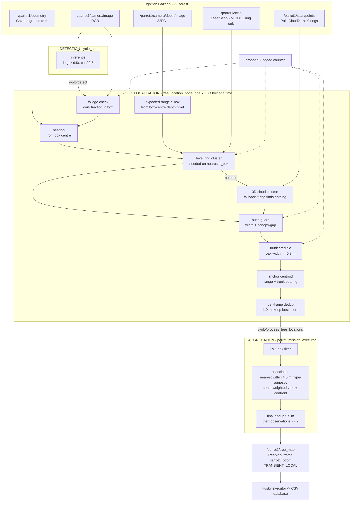

# rs1_perception

Perception nodes for the RS1 project: tree detection from the Parrot drone camera
and conversion of those detections into world-frame tree locations.

## Pipeline

Two nodes, both **pull-based services** - nothing is published per frame. The
mission executor drives detection on a timer, so the rate is controlled by the
consumer, not by the camera.



### Stage 1 - detection (`yolo_node`)

Subscribes the RGB camera and caches `latest_image`; it does **not** detect on
every frame. `/yolo/detect` (`start_yolo: bool` -> `YoloDetections`) runs the
backend on whatever the newest frame is and returns
`class_name, score, left/top/right/bottom` per box, plus an annotated frame on
`/yolo/debug_image`.

Backend is `pytorch` / `onnx` / `tensorrt` / `auto`. This choice does **not**
affect accuracy - the ONNX export is numerically identical to PyTorch (max abs
logit difference 5.8e-4). Class names come from the model: `OAK_TREE`,
`PINE_TREE`.

### Stage 2 - localisation (`tree_location_node`)

Takes the boxes from `/yolo/process_tree_locations` and runs each one through the
gate chain below **in this order**, so the logged counters tell you exactly where
a detection died:

| # | Gate | Reject counter | Uses |
| --- | --- | --- | --- |
| 1 | box at least `min_box_pixels` | (silent) | box |
| 2 | box shows foliage: fraction of pixels with grey < `dark_threshold` (100) at least `min_dark_fraction` (0.25) | `no tree in box` | RGB |
| 3 | bbox **centre** gives a valid bearing (the canopy centroid sits above an upright trunk) | `no lidar trunk echo` | TF |
| 4 | a trunk echo exists at that bearing, seeded on the echo nearest `r_box` (the box-centre depth range) | `no lidar trunk echo` | `/parrot1/scan` |
| 5 | if the ring found nothing, the 3D cloud finds a **vertical column**: z-span at least `cloud_min_column_span_m` (1.0 m) and per-level drift at most `cloud_column_max_spread_m` (0.5 m) | `not a vertical trunk` | `/parrot1/scan/points` |
| 6 | not a bush: narrowest cross-section at most `trunk_max_width_m` (1.8 m), **and** not much nearer than the surface above it | `bush` | `/parrot1/scan/points` |
| 7 | trunk is credible: an `OAK_TREE` echo at most `oak_trunk_max_width_m` (0.8 m) - wider means branches only | `branches only` | ring/cloud width |

Survivors are anchored as `base_x, base_y = sensor_origin + r_lidar * (cos, sin)(az_trunk)`,
i.e. the **lidar** sets the horizontal position, not the depth image - in a dense
forest the depth image's nearest return is a branch (measured: a branch at
az -30 deg / 1.9 m while the trunk was at az 0 deg / 5 m). Depth only supplies
`base_z` from the lowest visible trunk row. Finally, boxes closer than
`frame_dedup_distance` (1.0 m) within one response collapse to the highest score.

Frames: all positions are in `parrot1_odom`, which equals `world` numerically
because the EKF fuses the exact Gazebo pose. Sensor poses come from
`/parrot1/odometry` plus the *static* `base_link -> sensor` TF
(`use_truth_odometry: true`) - **not** from the EKF/SLAM chain, which corrupts
after a `set_pose` teleport.

### Stage 3 - aggregation (`parrot_mission_executor`)

The sweep runs a timer at `detection_rate_hz` (1.0) with only one request in
flight, calling `/yolo/detect` then `/yolo/process_tree_locations`. Each returned
`TreeLocation` is:

1. **ROI-filtered** - dropped if outside the sweep box + `roi_tree_margin`
   (0.0). This is what removes trees seen during the inbound transit.
2. **Associated position-agnostically** to any existing tree within
   `merge_distance` (4.0 m) *regardless of label*, so per-inference YOLO labels of
   the same tree aggregate into one score-weighted type vote. The centroid is
   trunk-anchored, so distinct trees are normally further apart than the gate.
   Confident detections pull the centroid harder than weak ones.

At the end, `publishTreeMap()` does a final greedy dedup at `final_merge_distance`
(5.5 m) - most-observed entry first, so wide-canopy oaks seen from both sides
collapse - then drops anything with `observations < min_observations` (2), because
a single sighting is usually a bad anchor or a false positive.

Output is `/parrot1/tree_map` (`TreeMap`, frame `parrot1_odom`,
TRANSIENT_LOCAL); the Husky executor consumes it and writes the CSV database.

### Read the counters, not the node output

Every response logs one line, and the counters are cumulative per response:

```
Processed 12 detection(s) -> 3 tree location(s) (0 dropped: no tree in box;
5 dropped: no lidar trunk echo; 1 dropped: not a vertical trunk;
2 dropped: bush (too wide / no canopy above); 1 dropped: branches only, no trunk)
```

A healthy run at search clearance is dominated by `no lidar trunk echo` (boxes
whose trunk is occluded or out of lidar range). A jump in `bush` means the drone
is flying low enough to have bushes in view. `--debug` on the node adds a
per-detection line with the bearing, range and the exact rejection reason.

| Node | Executable | Exposed as |
| --- | --- | --- |
| Tree detection | `tree_identification/yolo_node.py` | `/yolo/detect` service, `/yolo/debug_image` topic |
| Tree localisation | `tree_location/tree_location_processing.py` | `/yolo/process_tree_locations` service |
| Shared TF (simulation-owned) | `rs1_alignment/alignment` | `/tf`, `/tf_static` |

Helper clients: `scripts/test_tree_locations.py` (accuracy test),
`scripts/visualise_tree_locations.py` (RViz markers / Gazebo poles),
`scripts/map_tree_locations.py` (interactive map builder),
`scripts/measure_tree_geometry.py` (per-tree lidar calibration).

## Running

```bash
ros2 launch rs1_perception tree_identification.launch.py
# or pick a specific inference backend:
ros2 launch rs1_perception tree_identification.launch.py backend:=onnx
```

The launch file starts the two perception nodes. The simulation's
`rs1_alignment` component must already provide the shared world→map→odom→base
tree and robot-description sensor transforms. It starts by default with
`ros2 launch rs1_sim rs1_sim.launch.py`; do not run an additional alignment node.
The dashboard is optional and can start separately. The old direct truth-based
world→base broadcaster has been removed. Everything else (image size, thresholds,
class names) lives in `config/yolo.yaml`; the launch file only exposes the
backend selection and the model paths.

## Testing the inference backend

### Quick check - no simulation needed

Proves the chosen backend loads, the service answers, and boxes come back in
original-image coordinates. Start the node in one terminal:

```bash
ros2 run rs1_perception yolo_node.py --ros-args \
    -p backend:=onnx -p confidence_threshold:=0.01
```

and in another:

```bash
ros2 run rs1_perception test_yolo_backend.py --expect-backend onnx
```

It reads the node's parameters (so it *proves* which backend is live) and prints
them plus the detections:

```
/yolo_node configuration:
  backend                onnx
  provider               auto
  imgsz                  640
  onnx_model_path        (empty -> derived from model_path)
...
returned 1 detection(s)
  PINE_TREE  0.0212  [0,0,14,47]
  all boxes are inside the 720x480 frame  OK
RESULT: PASS
```

It exits non-zero if the backend does not match `--expect-backend`, so it works
as a regression check. Note the node must run with a **low
`confidence_threshold`** for this test: the frame published is a terrain texture,
not a tree scene, so at the default `0.5` you would correctly get zero
detections.

> This verifies plumbing, **not** detection accuracy - the "detections" on a
texture are meaningless noise. Use the simulation for accuracy.

### Full pipeline - with the simulation

Start `ros2 launch rs1_sim rs1_sim.launch.py`, which includes alignment, then
launch perception in the same ROS domain. Mission and dashboard launches can
run in their own terminals; see [launch ownership](../../../mission_control/LAUNCHING.md).
Consumers use the shared global
TF topics. XY/yaw registration is verified, but Parrot's unfused Z limits accurate
3D tree placement. The existing teleport-based `test_tree_locations.py` and tour
helpers are not valid localization-accuracy checks in this mode: teleporting a
model does not reset the EKF/SLAM estimate. Reset the whole session after a
teleport or map reset. Full vertical-localization and teleport-aware perception
validation are deferred.

## Inference backends

`yolo_node` can run the same detector three ways. Choose with the `backend`
parameter (`config/yolo.yaml`) or the `backend:=` launch argument.

| `backend` | Runs | Needs installed | GPU |
| --- | --- | --- | --- |
| `pytorch` | `best.pt` | `ultralytics` (pulls torch + torchvision) | optional |
| `onnx` | `best.onnx` | `onnxruntime` + numpy + opencv. **No torch.** | optional |
| `tensorrt` | the **same** `best.onnx`, on ONNX Runtime's `TensorrtExecutionProvider` | `onnxruntime-gpu` + TensorRT libraries. **No torch, no ultralytics.** | **required** |
| `auto` *(default)* | first usable of `tensorrt -> onnx -> pytorch` | depends on what is found | - |

Because TensorRT executes the ONNX graph, there is only **one model file to
produce and deploy**: `best.onnx`. The hardware available at runtime decides
whether that graph executes on TensorRT, CUDA or the CPU.

`auto` logs which backend it chose and why, e.g.

```
[INFO] [yolo_node]: backend=auto selected 'onnx' -> .../models/best.onnx
       (reason: tensorrt: TensorRT engine not found: .../models/best.engine ...)
```

If a requested backend is unusable you get one clear line instead of a traceback:

```
[FATAL] [yolo_node]: TensorRT engine not found: .../models/best.engine
        (build it on the GPU machine with `python yolo_training/export_onnx.py --format engine`)
```

### Which should I use?

**`onnx`**, and it does not need PyTorch: the runtime dependency drops from
roughly **4.4 GB** to **~50 MB**, and it works on a machine with no GPU and no
CUDA at all. On an NVIDIA machine the *same* file gets TensorRT acceleration by
switching `backend` to `tensorrt` - nothing has to be re-exported or rebuilt.

The model is exported from the trained `.pt` (see
[`yolo_training/README.md`](../../../yolo_training/README.md)); the `.pt` is never
required at runtime.

### Installing the requirements

```bash
cd rs1_ws/src/rs1_perception
pip install -r requirements/onnx.txt       # recommended: torch-free
pip install -r requirements/pytorch.txt    # only if you need the pytorch backend
pip install -r requirements/tensorrt.txt   # NVIDIA only, on top of onnx.txt
```

> **`onnxruntime` and `onnxruntime-gpu` are the same import name** and cannot be
> installed side by side. For TensorRT, remove the CPU build first:
> `pip uninstall -y onnxruntime && pip install -r requirements/tensorrt.txt`.
>
> If you have no NVIDIA GPU, install the CPU-only torch wheel **before**
> `requirements/pytorch.txt`, otherwise pip pulls the CUDA build and ~3 GB of
> `nvidia/*` libraries you cannot use:
> `pip install torch torchvision --index-url https://download.pytorch.org/whl/cpu`

The devcontainer already installs the ONNX profile (`.devcontainer/requirements.txt`),
so `backend:=onnx` works out of the box.

### TensorRT notes (NVIDIA users)

TensorRT is an **execution provider on the ONNX model**, not a separate artefact,
so there is no export step and no engine file to commit:

```bash
pip uninstall -y onnxruntime
pip install -r requirements/tensorrt.txt      # onnxruntime-gpu + TensorRT libs
ros2 launch rs1_perception tree_identification.launch.py backend:=tensorrt
```

Things worth knowing:

* **The engine is built on first use and takes minutes.** It is cached to
  `trt_cache_dir` (default `~/.cache/rs1_perception/tensorrt`) and reused
  afterwards. Do not mistake the first-run delay for a hang.
* **Engines are machine-specific** (GPU model + driver + CUDA + TensorRT
  version), which is exactly why they are cached locally instead of shipped.
* `provider: "tensorrt"` achieves the same thing while staying on
  `backend: "onnx"`; conversely `provider: "cpu"` is useful to keep the onnx
  backend off the GPU entirely.
* **Jetson / aarch64**: do not use the `onnxruntime-gpu` wheel - install NVIDIA's
  own onnxruntime build for your JetPack, which is compiled with the TensorRT
  provider.
* TensorRT only accelerates CUDA. On a machine without an NVIDIA GPU
  (`nvidia-smi` absent) this backend is simply unavailable - `auto` skips it and
  falls through to `onnx`.

## Configuration

`config/yolo.yaml`:

| Parameter | Default | Notes |
| --- | --- | --- |
| `backend` | `"auto"` | `auto` / `pytorch` / `onnx` / `tensorrt` |
| `provider` | `"auto"` | Execution provider for onnx/tensorrt: `auto` / `tensorrt` / `cuda` / `cpu`. |
| `trt_cache_dir` | `~/.cache/rs1_perception/tensorrt` | Where the TensorRT engine is cached. `""`/`"off"` disables caching. |
| `trt_fp16` | `true` | Allow TensorRT FP16. Ignored unless TensorRT is active. |
| `model_path` | `"best.pt"` | PyTorch weights. The launch file overrides this with an absolute path into `share/models/`. |
| `onnx_model_path` | `""` | Empty = `model_path` with the extension swapped to `.onnx`. Used by both the `onnx` and `tensorrt` backends. |
| `imgsz` | `640` | Letterbox size. pytorch accepts any value; onnx/tensorrt **must match the export size** (checked at startup). Independent of camera resolution. |
| `device` | `"auto"` | `auto` / `cpu` / `0`. Only used by the pytorch backend. |
| `confidence_threshold` | `0.5` | All backends. |
| `iou_threshold` | `0.45` | pytorch always; onnx/tensorrt for raw-head exports. |
| `class_names` | `[""]` | Override class names; empty = read them from the model. |
| `publish_debug_image` | `true` | Publish the annotated frame. |
| `image_topic` / `debug_image_topic` | `/parrot1/camera/image` / `/yolo/debug_image` | |

Class names are read from the model itself: the ONNX metadata for the onnx and
tensorrt backends (Ultralytics embeds `names`), `model.names` for pytorch.

**Model path resolution.** An absolute `model_path` / `onnx_model_path` is used
as-is. A *relative* one (such as the `best.pt` default) is looked for in the
current working directory first and then in the package's installed
`share/rs1_perception/models/` directory. That means
`ros2 run rs1_perception yolo_node.py --ros-args -p backend:=onnx` works from any
directory without having to spell out the path - the launch file just passes the
absolute path explicitly for clarity.

### Threshold behaviour per backend

* **pytorch** - `confidence_threshold` and `iou_threshold` both apply.
* **onnx / tensorrt with a raw-head export** *(default export)* - both apply,
  because the node decodes and NMS-filters the graph output itself. Behaves like
  pytorch.
* **onnx / tensorrt with an end-to-end export** (`export_onnx.py --e2e`) - NMS and
  a confidence floor are baked into the graph. `iou_threshold` has no effect, and
  `confidence_threshold` cannot go below the `--conf` used at export time.

`config/tree_location.yaml` (trunk confirmation):

| Parameter | Default | Notes |
| --- | --- | --- |
| `lidar_topic` | `/parrot1/scan` | Single `LaserScan` = the **middle ring** of the 9-ray lidar, level with the drone. |
| `lidar_cluster_depth_gap` | `0.3` | A trunk is a short contiguous run of near beams; beams beyond `front + gap` are background. |
| `lidar_cluster_min_beams` | `2` | Minimum contiguous beams for a valid trunk echo. |
| `lidar_cluster_max_width_m` | `3.0` | Wider than this is canopy, not a trunk. |
| `oak_trunk_max_width_m` | `0.8` | An oak echo wider than this is branches/foliage only, so the detection is dropped. Pines are cones and are exempt. |
| `use_pointcloud` | `true` | Enable the full 3D cloud **fallback** below. |
| `pointcloud_topic` | `/parrot1/scan/points` | Same sensor, all 9 rings, ±15° vertical fan. |
| `cloud_max_age_s` | `2.0` | Older than this and the cloud is treated as missing. |
| `cloud_angle_tolerance` | `0.09` | rad; azimuth sector allowed around the YOLO bearing. |
| `cloud_depth_gap` | `0.6` | m; points within this of the front surface belong to the trunk. |
| `cloud_level_bin_m` | `0.5` | m; height bin used by the vertical-column test. |
| `cloud_column_max_spread_m` | `0.5` | Max std-dev of the per-level lateral centres — a real trunk is a column. |
| `cloud_min_column_span_m` | `1.0` | m; a trunk spans height, a branch sheet seen edge-on does not. |
| `trunk_max_width_m` | `1.8` | Bush guard: the narrowest cross-section must be under this. |
| `bush_sector_rad` | `0.35` | rad (~20°); wide, so a whole 2.5 m bush fits in the measurement sector. |
| `bush_lateral_gap_m` | `0.3` | m; lateral break separating two different objects. |
| `canopy_probe_depth_m` | `1.2` | m; how far behind the front the candidate object extends. |
| `canopy_gap_m` | `0.5` | m; vertical gap above the object before looking for what is above it. |
| `trunk_canopy_max_gap_m` | `2.5` | m; trunk this much nearer than the surface above it means bush. |

### Why the point cloud exists, and why it is only a fallback

`/parrot1/scan` is a single ring at the drone's own altitude, so it only finds a
trunk while the drone happens to be flying at trunk height. As soon as the mission
changes altitude — a duck to 0.8 m passes **under** the trunk, a pop-up to 8-12 m
goes **over** it — that ring sees nothing and every detection is dropped, exactly
when the drone most needs to keep mapping.

`/parrot1/scan/points` is the same sensor with all nine rings, so its ±15° vertical
fan always crosses the trunk whatever the altitude. It is used **only when the ring
finds nothing**: `_cloud_trunk_at` clusters the points in a narrow azimuth sector
around the YOLO bearing, then bins them by height and checks that the lateral centre
of each level stays put (`cloud_column_max_spread_m`) and that the cluster actually
spans height (`cloud_min_column_span_m`). Making the cloud the *preferred* path was
tried and is wrong — at cruise altitude it accepts branch sheets the single ring
correctly rejects, taking location precision from 1.00 to 0.69.

### Why bushes are rejected geometrically, not by the detector

**The model cannot do this job.** `yolo_training/database/model_db.csv` contains
only two classifications (`OAK_TREE`, `PINE_TREE`), and
`sample_generator/sample_gen/models/` contains nothing but `trees` - there is no
bush class and no negative examples anywhere in the training pipeline. A bush is
therefore pure out-of-distribution input and comes back confidently labelled
`OAK_TREE`. Retraining is the only way to fix that at the detector; until then
the filter has to be geometric.

Measured geometry (`rs1_sim/models`, do not re-derive):

| Object | Width | Height |
| --- | --- | --- |
| `bush_2` collision cylinder (r 1.25, len 1.5) | **2.5 m** | 1.5 m |
| `bush_3` collision cylinder (r 1.35, len 2.1) | **2.7 m** | 2.1 m |
| oak trunk | 0.1-0.8 m | tall |
| pine cone base | 1.1-1.5 m | tall |

`_cloud_bush_check` runs two tests and drops the detection if either fires:

1. **No narrow column anywhere.** Bin the candidate by height and, at each level,
   measure the contiguous lateral run straddling the trunk bearing. The
   *narrowest* cross-section is the test value: a trunk always has a narrow one,
   a bush has none. Using the narrowest rather than the widest also stops a
   tree's own canopy (wide, and only slightly nearer than its trunk) from
   inflating the measurement and rejecting real trees.
2. **Trunk vs canopy range.** A trunk continues upward into its own canopy, so
   the nearest surface above it is at a similar range - on an oak the low
   branches are usually slightly *nearer* than the trunk. A bush is a low blob
   with only sky or much more distant geometry above it. So *trunk much nearer
   than the canopy above it* means the "tree" is a foreground blob.

The candidate is gathered in a **much wider sector** (`bush_sector_rad`, ±20°)
than the trunk search (`cloud_angle_tolerance`, ±5°). This matters: ±5° at 5 m
is only ±0.45 m of lateral extent, far narrower than a 2.5 m bush, so measuring
width inside the search sector can never see the bush and the test silently
never fires. That bug was caught by an offline synthetic test before it ever ran
in sim.

Validated offline against synthetic geometry (oak, pine, both bushes, an
occluded bush sliver, and a trunk standing beside a bush) and in sim: location
precision stayed 1.00 while the guard was rejecting ~50 bush detections.

> **Note:** an earlier bush filter based on tree *height* (`min_tree_height_m`,
> box-top world z minus the detection's own trunk-base z) was explored but was
> never committed and is **not** in the tree. Bushes are currently rejected by the
> two geometric tests above only. If you re-add a height gate, keep it above
> ~2.6 m - `bush_3` is 2.1 m tall and short trees exist.

## Measured performance

Measured on the dev machine (AMD Ryzen 5 7535U, 12 threads, **no GPU**), same
image and 30 iterations:

| Backend | mean | ~FPS |
| --- | --- | --- |
| `pytorch` | 40-49 ms | 21-25 |
| `onnx` (raw head) | ~41 ms | ~24 |
| `onnx` via ultralytics | 69 ms | 14 |
| `tensorrt` | GPU only - not measurable here | - |
Two conclusions worth keeping in mind:

1. **Swapping runtimes buys essentially nothing on CPU.** ONNX and PyTorch are
   within noise of each other; going through Ultralytics' own ONNX path is
   actively *slower* because of its wrapper overhead. Choose `onnx` for the
   dependency/portability win, not for speed.
2. **The effective lever is `imgsz`**, not the runtime: 640 -> 480 was ~1.8x
   faster. The model was trained at 640, so re-validate accuracy with
   `yolo_training` before changing it.

Inference is also not the bottleneck of this pipeline - it takes ~40 ms versus
a multi-second simulation snapshot cycle.

## Gotchas

* **`install(PROGRAMS)` executes the `.py` files directly**, so every node must
  keep its `#!/usr/bin/env python3` shebang and its executable bit. A missing
  shebang shows up as `OSError: [Errno 8] Exec format error`.
  Check with `head -c 16 <file> | xxd` (expect `2321 2f75 7372...`).
* **Never import `cv_bridge`.** ROS 2 Humble's `cv_bridge` is built against
  NumPy 1.x while the system Python has NumPy 2.x, which leads to
  `AttributeError: _ARRAY_API not found` and then a SIGSEGV. Images are decoded
  manually with `np.frombuffer(bytes(msg.data))` instead.
* **`imgsz` must match the ONNX export.** The exported graphs have a *static*
  input size, so the `onnx` and `tensorrt` backends only accept the size they were
  exported at. Changing `imgsz` is therefore fine on `pytorch` (Ultralytics
  re-letterboxes per call) but needs a re-export for the others:
  `export_onnx.py --format onnx --imgsz 480`. A mismatch is reported once at
  startup, and `backend: auto` falls through to a backend that does accept it,
  rather than failing on every detection request.
* **`imgsz` is unrelated to camera resolution.** 720x480 frames are letterboxed to
  `imgsz` automatically; changing the camera resolution does not require changing
  `imgsz`.
* **Exported models are large binaries.** `models/best.onnx` is ~9.8 MB; decide
  deliberately whether to commit it (committing it makes the torch-free
  deployment story work out of the box) or to generate it during deployment.
* **`onnxruntime` and `onnxruntime-gpu` collide** - they are two builds of the
  same `onnxruntime` import. Install only one; uninstall the CPU build before
  installing the GPU one.
* **The first TensorRT run is slow** (minutes) because the engine is being built;
  it is then cached in `trt_cache_dir`. Delete that directory to force a rebuild
  after upgrading TensorRT or the GPU driver.
* Scripts started from a launch file receive `--ros-args ...` appended, so plain
  `argparse` rejects them. Use `remove_ros_args(sys.argv)[1:]`.
* **Stale `install/` breaks things silently.** If the pipeline stops working
  after a branch switch, rebuild before debugging:
  `colcon build` (or at least `rs1_interfaces` + `rs1_perception`).

## Husky ground filtering

Husky localisation starts `husky_ground.launch.py` automatically. The pipeline is:

1. `level_husky_cloud.py` pairs the 3D LiDAR cloud with a recent IMU orientation,
   transforms the sensor mounting offset into the base frame, and removes roll
   and pitch. Yaw remains the responsibility of the existing planar EKF.
   Reflections inside the chassis/sensor envelope are excluded.
2. The unmodified GSeg3D ROS node separates `/husky1/points_level` into
   `/husky1/ground_points` and `/husky1/obstacle_points`.
3. `ground_relative_scan_cloud.py` checks obstacle candidates against small planes
   fitted to nearby segmented ground. Ground samples are averaged within 20 cm
   XY squares before selecting neighbours, so one dense LiDAR ring cannot dominate
   the fit. Obstacle candidates are not downsampled. It removes leftover ground
   fragments and
   points above Husky's 1 m collision envelope where the ground estimate is reliable.
   Points without reliable nearby ground remain obstacles conservatively. This
   produces `/husky1/navigation_points`; a fixed robot-relative height cutoff would
   miss real obstacles farther uphill.
4. `pointcloud_to_laserscan` projects that cloud into `/husky1/scan_filtered`
   for SLAM and the global obstacle layer. Empty directions
   remain infinite, rather than inventing a clear ray beyond removed ground.
5. The local costmap uses the standard obstacle layer with `/husky1/scan_filtered`,
   followed by inflation. The ground-consistency plugin is no longer enabled;
   the ground and obstacle clouds remain available for filtering and inspection.

The virtual `husky1_base_level` frame uses the planar EKF base origin. It describes
corrected measurements, not the physical chassis attitude. Its ground seed is
therefore `-0.13228` m (the wheel clearance below the base), not the original
LiDAR-to-ground distance. This preserves 2D navigation; it does not provide a
globally consistent elevation estimate or a full traversability map.

Husky-specific settings live in `config/husky_ground_segmentation.yml` and
`launch/husky_ground.launch.py`, leaving the three external submodules unchanged.
Install dependencies with the project's normal rosdep setup, then build and
source the workspace. The converter dependency is `ros-humble-pointcloud-to-laserscan`;
the ground-relative scan adapter also needs `python3-scipy`.

To inspect the pipeline independently in a running Husky simulation:

```bash
ros2 launch rs1_perception husky_ground.launch.py
```

Run that command only when the localisation launch is not already starting the
pipeline (`ground_filter:=false` disables that launch inclusion). In RViz, inspect
the ground and obstacle clouds together before trusting the resulting map.
Changing the filter does not automatically remove previously mapped terrain from
SLAM. No automatic SLAM reset or map-clearing behaviour is added by this pipeline.

The geometry checks are registered with `colcon test --packages-select rs1_perception`.

### Current validation limits

The October 2026 simulation comparison used fresh worlds and SLAM maps, the same
controller settings, and physical position only for evaluating arrival (within
0.5 m). The final pipeline reached both 14 m riverbank uphill goals that the raw
scan configuration could not reach. It also completed the tree-detour control,
although that route took 19.2 simulated seconds versus 16.5 originally.

This is still experimental: two runs using normal Husky bringup and its custom
NavigateThroughPoses behaviour tree gave one success and one failure. The failure
reported a starting pose in collision space: SLAM's cell under the robot was free,
but an occupied cell about 0.64 m away made the global costmap's padded footprint
region inscribed. Sparse residual terrain returns still survive filtering, so the
ground-consistency local layer alone cannot guarantee a clean global SLAM map.
Do not interpret the controlled route successes as a reliable whole-mission rate.

An ablation using the same filtered scan with the standard local obstacle layer
also passed the first bank route (19.3 s versus 19.1 s with the ground layer).
That single pair supports the benefit of filtering, but does not establish an
additional performance benefit from the new costmap plugin. The standard-layer
comparison used the filtered 2D scan, not a separate full 3D obstacle-cloud input.

The subsequent eight-run comparison used NavigateThroughPoses on two bank routes
and a tree detour, with the first bank route repeated. The standard obstacle layer
passed 4/4 runs; ground consistency passed 3/4. The standard layer is now the
configured default. This small sample does not establish a general success rate.
Separate prototype tests improved ground-neighbour selection using 20 cm XY
support cells and tested a 30-degree segmentation slope limit. Both changes are
now applied to the working pipeline. The slope setting admits the measured
26-degree bank patch; it is a segmentation threshold, not proof that all accepted
terrain is traversable. Residual terrain artifacts can still remain.

The production-filter retest completed all six NavigateThroughPoses trials (two
runs each of the two banks and tree detour), with final physical errors of
0.29--0.38 m. Bank A took 19.29/19.09 s, bank B 19.27/33.89 s, and the tree route
22.30/18.54 s. The slow bank run needed the existing local-costmap clear after a
progress failure. Both tree runs encountered transient lethal-start errors; the
first also used spin recovery. These are successful arrivals, not six clean runs.
No SLAM resets or additional clearing behaviour were introduced; each isolated
trial began with its own normal launch. Existing contaminated-map recovery was
not tested.

The traced bank-B ground patch contributed 65 navigation points across five
clouds in the earlier standard-layer run, versus zero in both updated runs.
Other ground leakage remains. Traced blocking cells on the tree route instead
matched returns 3.5--4.5 m above terrain: unreliable/missing nearby ground made
the helper conservatively retain overhead canopy points. The two changes do not
solve this separate limitation. Replay on identical recorded clouds did not reduce
the measured count of 20--90 cm obstacle returns, with helper median processing times rising
by about 2--3.4 ms per cloud. See `.mission-control/ground-filter-retest-20261030/`
at the repository root for configuration snapshots, logs and JSON comparisons.

These were Husky-only tests. They do not validate Parrot, mission handoff, or the
combined simulation load. The new sensor processing uses measured IMU orientation,
not the simulator's ground-truth pose or terrain mesh; those were used only by the
test observer. The planar EKF and its existing input sources are unchanged.
